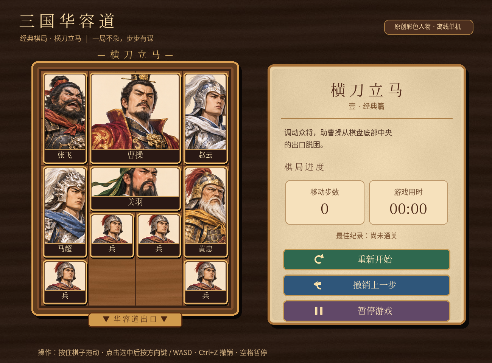

# 三国华容道 · 横刀立马 / Three Kingdoms Klotski

[](https://github.com/OrangePerfume/SanGuoHuaRongDao/actions/workflows/ci.yml)
[](LICENSE)

一款适用于 **Windows 10 / Windows 11** 的离线单机华容道游戏：经典「横刀立马」规则、彩色木质棋盘、原创三国人物插画。向经典文曲星益智游戏的玩法致意，但不照搬黑白屏幕。

**计划首发版本：v0.1.0**。这是首个公开发布的功能版本，仍处于持续开发和完善阶段。



> 图片为项目资源制作的静态预览，不是 Windows 上的实际截图。界面与操作体验以运行的 EXE 为准。

## 游戏玩法

- 标准 **4×5 横刀立马** 棋局，10 枚棋子和 2 个空位。
- 曹操 **2×2**，关羽 **2×1**，四员竖将 **1×2**，四名小兵 **1×1**。
- 不允许穿越棋子、重叠、旋转；把曹操移至棋盘**底部中央**即可获胜。
- **鼠标**：按住棋子水平或垂直拖动，支持路径合法时连续移动多格。
- **键盘**：选中棋子后，方向键或 WASD 移动；Ctrl+Z 撤销，R 重开，空格暂停或继续。
- **计步与计时**：每移动一格计一步，首次有效移动后开始计时。通关保存本地最佳成绩。

本页描述的是 **v0.1.0** 功能。点击目标格自动移动、Ctrl 多选同步移动将在 **v0.2.0** 中提供，**不包含在 v0.1.0** 中。

## 下载与运行 / Download

在 [Releases](https://github.com/OrangePerfume/SanGuoHuaRongDao/releases) 页面下载 `SanGuoHuaRongDao-v0.1.0-win-x64.zip`（需等 GitHub Actions 构建并发布成功后出现）。解压后运行：

`SanGuoHuaRongDao/SanGuoHuaRongDao.exe`

整个 `SanGuoHuaRongDao` 文件夹必须完整保留，不要单独取出 EXE。游戏本身无需联网。

## Windows 源码运行 / Run from source

建议安装 Python 3.12 x64：

```bat
py -3.12 -m venv .venv
.venv\Scripts\python -m pip install -r requirements.txt
.venv\Scripts\python main.py
```

也可以双击 `build.cmd`，它会安装构建依赖、运行测试、然后生成目录式 Windows EXE：

`dist\SanGuoHuaRongDao\SanGuoHuaRongDao.exe`

首次下载依赖需要联网；成品游戏运行不需要网络。

## 代码结构 / Project structure

| 路径 | 用途 |
| --- | --- |
| `huarongdao/core.py` | 棋局状态、边界/碰撞规则、求解器 |
| `huarongdao/model.py` | 撤销、计步、计时、游戏状态 |
| `huarongdao/gui.py` | PySide6 / Qt 用户界面 |
| `huarongdao/records.py` | 本地最佳成绩 |
| `huarongdao/assets/` | 木质纹理、图标及角色立绘 |
| `tests/` | 单元测试与 Qt 界面烟雾测试 |
| `build.cmd` | Windows 本地构建 |
| `.github/workflows/` | CI 测试、Tag 发布 Windows ZIP |

## 测试及兼容性说明

V0.1.0 在无 Qt 的环境中运行了 **17 项 pytest 测试（另有 12 项子测试）并通过**，Qt 图形烟雾测试因缺少 PySide6 跳过。游戏已获得首次 Windows 人工通关反馈，但自动构建、不同屏幕缩放比例的显示效果仍需要进一步验证。工作流上的成功表示构建与自动化测试通过，不等于全平台人工验收。

## 开源许可与素材 / License and assets

项目代码及随项目提供、由本项目制作的图像素材按 [MIT 许可证](LICENSE) 发布（以相应权利依法能够授权的范围为限）。三国人物插画由 AI 辅助创作，**未使用影视作品或其他电子游戏的现成截图**；木纹与图标由脚本生成。依赖组件继续适用它们自己的开源许可证。

- **PySide6 / Qt for Python**：官方提供 LGPLv3 / GPLv3 等许可选择；再分发打包 DLL 时请履行适用许可义务。
- **PyInstaller**：作为构建工具使用，其许可例外允许发布采用其他许可的程序，但仍须遵守应用依赖的许可证。

贡献与问题反馈可通过 GitHub Issues 提交。请附 Windows 版本、操作步骤、期望结果和实际结果，不要上传包含隐私信息的日志。

---

## English summary

**Three Kingdoms Klotski** is a fully offline sliding-block puzzle for Windows 10/11 featuring the classic 4×5 *Heng Dao Li Ma* layout, painted character tiles, and a wooden game board. Guide Cao Cao (the 2×2 block) to the bottom-center exit. Use drag-and-drop or arrow/WASD keys; undo, pause, move counting, timer, and local best-record tracking are included. This first GitHub release is **v0.1.0**, the initial feature release. Source code and project-created assets are offered under the MIT license subject to applicable rights; third-party Qt/PySide6 dependencies keep their own licenses. Character artwork was AI-assisted.
