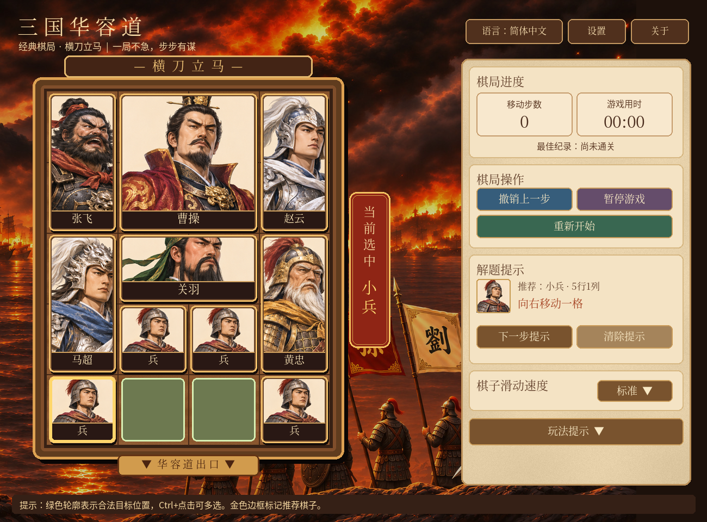

[简体中文](../../README.md) · [繁體中文](../../docs/zh-TW/README.md) · [English](../../docs/en/README.md)

# Three Kingdoms Klotski — Heng Dao Li Ma (V0.4.0)

[](https://github.com/OrangePerfume/SanGuoHuaRongDao/actions/workflows/ci.yml) [](../../LICENSE)

A fully offline sliding-block puzzle for **Windows 10 / 11**, featuring the classic *Heng Dao Li Ma* layout, a richly colored wooden board, and Three Kingdoms character illustrations. It brings back the **gameplay**, not the monochrome display.

**Version: 0.4.0.** Added live in-game language switching for Simplified Chinese, Traditional Chinese, and English, with saved preferences.



> This is a static preview assembled from project artwork. The game UI and documentation both support Simplified Chinese, Traditional Chinese, and English in one Windows EXE.

## Interface language

- Use the **Language** button in the upper-right corner to choose **简体中文 / 繁體中文 / English**.
- Board labels, character names, controls, help, records, and dialogs change instantly, without restarting the game.
- Simplified Chinese is the default; your last selection is saved. Changing language does not reset the puzzle, undo history, timer, or animation speed.

## Rules

- The board has **4 columns × 5 rows**, 10 pieces, and two empty cells.
- Cao Cao occupies **2×2**; Guan Yu **2×1**; four vertical generals each **1×2**; four soldiers each **1×1**.
- Pieces slide horizontally or vertically only. Rotation, overlap, jumping over pieces, and moving outside the board are not allowed.
- Win by moving Cao Cao to the **bottom-center exit**.

## Controls

- **Mouse drag**: Hold a piece and drag it horizontally or vertically. Every intermediate cell must remain legal.
- **Keyboard**: Select a piece, then use the arrow keys or WASD to move one cell at a time.
- **Shortcuts**: Ctrl+Z to undo, R to restart, Space to pause or resume.
- **Steps and timer**: Each piece moving one cell counts as one step; the timer starts on the first valid move. Best results are saved locally after a win.
- **Click-to-move**: Select a piece, then click an available green destination cell. It moves along a legal straight path, clearing the selection and hint after a successful mouse move.
- **Ctrl multi-selection**: Hold Ctrl while selecting additional pieces. The group can move in the same direction by the same distance; any collision or out-of-bounds movement rejects the operation.
- **Full-shape destination hints**: Cao Cao has one 2×2 square hint; the horizontal general has a 2×1 rectangle; vertical generals have 1×2 rectangles; soldiers have 1×1 squares. Hints are not broken into per-cell boxes.
- Merged overlapping destination outlines in the same direction into one uniformly filled rectangle while preserving legal movement distances.
- **Group undo**: One synchronized movement is undone as a single action; the step count remains the number of pieces times the number of cells moved.

- **Smooth animation**: Rapid successive moves continue from each piece’s current displayed position; undo also animates back smoothly.
- **Animation speed**: Choose Slow, Normal, or Fast in the right-hand control panel. The preference persists across launches.
- **Help panel layout**: The right-side instructions are grouped and wrap automatically; scroll within the panel to read everything in a smaller window.

## Download and run

Download the version-matched `SanGuoHuaRongDao-v0.4.0-win-x64.zip` from [GitHub Releases](https://github.com/OrangePerfume/SanGuoHuaRongDao/releases). Extract the entire ZIP, then run:

`SanGuoHuaRongDao.exe`

The executable embeds its runtime resources; no separate Python or Qt installation or network access is required. Retain README.md and LICENSE.txt.

Switched Windows distribution to a single-file EXE with a ZIP containing only the executable, README.md and combined LICENSE.txt.

## Running from source / building for Windows

Python 3.12 x64 is recommended:

```bat
py -3.12 -m venv .venv
.venv\Scripts\python -m pip install -r requirements.txt
.venv\Scripts\python main.py
```

Run `build.cmd` from the repository root to install build dependencies, execute the tests, and produce `dist\SanGuoHuaRongDao.exe`. Installing dependencies for the first time requires network access. The build reports measured sizes for the EXE and full distribution folder; the release workflow also measures the ZIP archive.

## Project layout and verification

| Path | Purpose |
| --- | --- |
| `huarongdao/core.py` | Board rules, collisions, and the puzzle solver |
| `huarongdao/model.py` | Game session, undo, timing, and move counting |
| `huarongdao/gui.py` | PySide6 / Qt user interface |
| `huarongdao/i18n.py` | Simplified Chinese, Traditional Chinese, and English UI text |
| `huarongdao/records.py` | Local best-result storage |
| `huarongdao/assets/` | Character art, wooden textures, and icons |
| `tests/` | Rules, assets, GUI smoke tests, and documentation checks |
| `.github/workflows/` | Windows CI and tag-triggered releases |

Strict test command: `python -X faulthandler tools/run_tests.py --require-qt`. Windows CI covers game rules and the Qt interface; failing checks block the build.

## License and more information

The project uses the [MIT License](../../LICENSE). See [Third-party notices](THIRD_PARTY_NOTICES.md) for Qt/PySide6 and other dependency obligations. Character artwork was made for this project with AI assistance; no existing movie, television, or game screenshots are included.

[Changelog](CHANGELOG.md) · [Contributing](CONTRIBUTING.md) · [Third-party notices](THIRD_PARTY_NOTICES.md) · [Releases](https://github.com/OrangePerfume/SanGuoHuaRongDao/releases)
