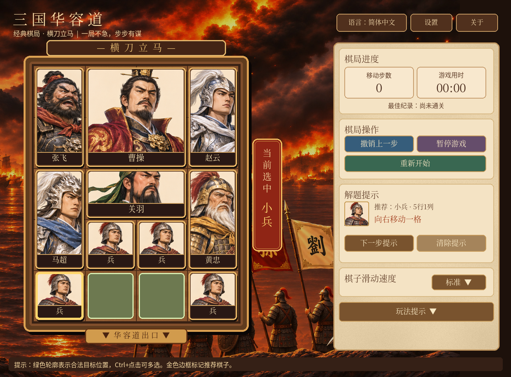

[简体中文](../../README.md) · [繁體中文](../../docs/zh-TW/README.md) · [English](../../docs/en/README.md)

# 三國華容道 · 橫刀立馬（V0.3.0）

[](https://github.com/OrangePerfume/SanGuoHuaRongDao/actions/workflows/ci.yml) [](../../LICENSE)

這是一款適用於 **Windows 10 / 11**、完全離線的單機華容道遊戲。保留經典「橫刀立馬」玩法，搭配彩色木質棋盤與三國人物插畫。懷舊的是遊戲體驗，而不是黑白螢幕。

**版本：0.3.0**。改善連續移動及復原動畫，新增慢、標準、快三種速度，並完善 Windows 自動發行流程。



> 圖片僅是靜態素材預覽，不能視為 Windows 實際執行畫面。遊戲介面目前仍是簡體中文；本頁提供的是**繁體中文專案文件**。

## 遊戲規則

- 棋盤為 **4 欄 × 5 列**，共 10 枚棋子及兩個空格。
- 曹操佔 **2×2**、關羽 **2×1**、四位直向武將各 **1×2**、四名小兵各 **1×1**。
- 棋子只能水平或垂直滑動，不可旋轉、穿越、重疊或超出邊界。
- 將曹操移動到棋盤**底部中央出口**即可過關。

## 操作方式

- **滑鼠拖曳**：按住一枚棋子並沿水平或垂直方向拖曳，所有經過的格位皆須合法。
- **鍵盤**：點選棋子後使用方向鍵或 WASD，每次移動一格。
- **快捷鍵**：Ctrl+Z 復原、R 重新開始、空白鍵暫停 / 繼續。
- **步數與計時**：每枚棋子每移動一格計一步；首次有效移動開始計時；過關後儲存本機最佳成績。
- **點選移動**：點選棋子後，再點選綠色的合法目標空位，棋子會沿合法直線移動；成功後清除選取及提示。
- **Ctrl 多選**：按住 Ctrl 逐一點選棋子，可將多枚棋子朝相同方向、以相同距離一起移動；任何棋子碰撞或越界則該次移動無效。
- **完整目標提示**：曹操為單一 2×2 正方形、橫向武將為 2×1 長方形、直向武將為 1×2 長方形、小兵為 1×1 正方形，不會拆成多個小方塊。
- **群組復原**：一組同步移動可一次復原；步數仍依棋子數量與位移格數計算。

- **棋子滑動動畫**：快速連續操作會從棋子目前顯示位置接續滑動；復原時亦會平順返回。
- **滑動速度**：右側操作區提供慢、標準、快三種速度，自動記住使用者的設定。
- **玩法提示排版**：右側提示區依操作類型顯示說明並自動換行；視窗較小時可在提示區內捲動閱讀全文。

## 下載與執行

請至 [GitHub Releases](https://github.com/OrangePerfume/SanGuoHuaRongDao/releases) 下載與版本對應的 `SanGuoHuaRongDao-v0.3.0-win-x64.zip`（成功建置並發行後才會出現），完整解壓縮並執行：

`SanGuoHuaRongDao/SanGuoHuaRongDao.exe`

請保留程式資料夾中的所有相依檔案，不要只複製 EXE。遊戲執行時不需要網路連線。

## 原始碼執行 / Windows 建置

建議使用 Python 3.12 x64：

```bat
py -3.12 -m venv .venv
.venv\Scripts\python -m pip install -r requirements.txt
.venv\Scripts\python main.py
```

在專案根目錄執行 `build.cmd` 可安裝建置相依套件、先執行測試，再產生 `dist\SanGuoHuaRongDao\SanGuoHuaRongDao.exe`。首次安裝相依套件需要網路。建置後會顯示 EXE 及整個程式資料夾的實測容量；自動發行時也會統計 ZIP 容量。

## 專案結構與測試

| 路徑 | 用途 |
| --- | --- |
| `huarongdao/core.py` | 棋局規則、碰撞判定及求解器 |
| `huarongdao/model.py` | 遊戲狀態、復原、計時與步數 |
| `huarongdao/gui.py` | PySide6 / Qt 介面 |
| `huarongdao/records.py` | 本機最佳成績 |
| `huarongdao/assets/` | 人物插畫、棋盤材質與圖示 |
| `tests/` | 規則、資源、GUI 基本測試及文件一致性測試 |
| `.github/workflows/` | Windows CI 及標籤發行 |

嚴格測試指令：`python -X faulthandler tools/run_tests.py --require-qt`。CI 在 Windows 安裝 Qt 後執行；非 Qt 環境測試通過不代表已完成 Windows 實機驗收。

## 授權與其他文件

專案採用 [MIT 授權](../../LICENSE)；Qt/PySide6 及其他相依套件的授權見 [第三方元件聲明](THIRD_PARTY_NOTICES.md)。人物圖像是為本專案以 AI 輔助創作的素材，未採用影視或其他遊戲的既有截圖。

[更新紀錄](CHANGELOG.md) · [貢獻指南](CONTRIBUTING.md) · [第三方元件聲明](THIRD_PARTY_NOTICES.md) · [發行版本](https://github.com/OrangePerfume/SanGuoHuaRongDao/releases)
